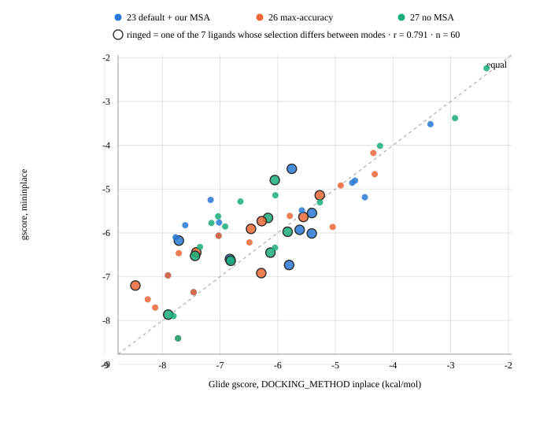
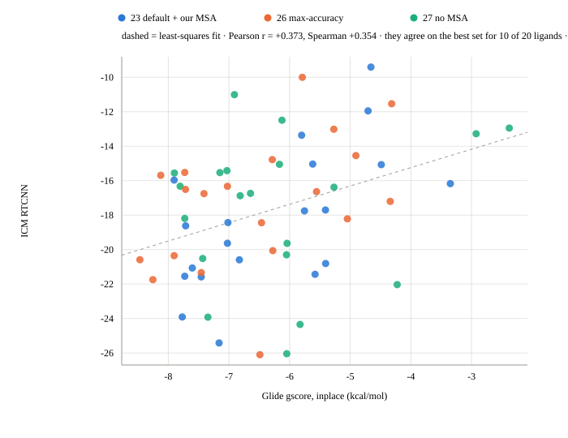

# Analysis 28 — `inplace` vs `mininplace`

**Question.** Every Glide-based selection shipped here (submissions 13, 18, 19, 20, 21,
24) used `DOCKING_METHOD mininplace`, on one argument: plain `inplace` returns emodel and
einternal as 0.00, and emodel is Glide's own pose-ranking term. That had never been
tested against a leaderboard metric, and testing it by shipping two submissions would
cost two attempts.

Instead: score the three ESMFold2 sets both ways and ask whether the modes would even
pick different structures. 60 structures × 2 modes, one grid per structure so the mode is
the only thing that varies.

## The modes are not interchangeable

| | |
|---|---|
| `inplace` emodel | 0.0 for every structure — the original argument holds |
| Pearson r between the two modes' gscore | **0.791** |
| median `mininplace` − `inplace` gscore | +0.177 (range −0.93 to +1.92) |
| **selections that differ** | **7 of 20** |

So the mode materially changes which structure gets picked. A comparison of the two as
submissions would be measuring something real.

## What the pick distribution does and does not show

| set | LDDT-PLI |
|---|---|
| 23 default endpoint + ColabFold MSA | **0.4527** |
| 26 max_accuracy, own MSA | 0.4365 |
| 27 default endpoint, no MSA | 0.4384 |

| selector | picks 23 | picks 26 | picks 27 |
|---|---|---|---|
| Glide `mininplace` | 7 | 7 | 6 |
| Glide `inplace` | 6 | 9 | 5 |
| ICM RTCNN (analysis 29) | 6 | 6 | 8 |

**This table cannot measure selector skill, and an earlier version of this README wrongly
used it to.** The reasoning was that chance is 6.67 each, all three selectors land near
it, and submission 23 is the better set by ~0.015 LDDT-PLI, so none of them prefers the
better set. That does not follow.

The 0.015 gap is a *mean* over the ~10 structures the organizers score. It does not say
23 is better for most individual ligands. Analysis 27 measured a median pocket-superposed
ligand RMSD of 1.53 Å between sets 23 and 27, so the runs produce genuinely different
poses per ligand and may well trade off ligand by ligand — 23 better here, 27 better
there, with 23 ahead only on average. Under that entirely plausible structure, a
**perfect oracle also picks roughly a third from each set**. The test therefore cannot
distinguish an oracle from a coin: it has no power, and nothing about selector skill can
be read off it either way.

What the table does show is unremarkable: the three selectors disagree with each other,
which is already clear from the 7-of-20 mode difference above.

## Conclusion — superseded by submission 29, use `inplace`

This originally concluded "keep `mininplace`", on the grounds that the emodel argument
was the only discriminating reason either way. **That recommendation is withdrawn.**

Submission 29 selected among the three sets by `inplace` gscore and scored
0.4638 / 3.7277 / 0.8001, beating its best parent on all three metrics and setting the
project's best LDDT-PLI. Every Glide selection that previously failed — submissions 13,
18, 20, 24 — used `mininplace`.

The emodel argument never applied to these selections anyway: they rank on gscore alone,
so zeroed emodel costs nothing. And the finding above points the same way — `mininplace`
gives the worse score for 38 of 60 structures, consistent with its restrained
minimisation moving the pose off the co-folded geometry before `POSTDOCK` rescores it.
For structures we did not dock, score the pose as it stands.

## What the real evidence against physics-score selection is

Not this table. The measurements are:

* **Analysis 09**, scored against known RMSD on crystal structures: within-ligand
  Spearman of **+0.086** for Glide gscore and **+0.334** for ICM RTCNN, the latter
  positive in 20 of 30 cases.
* **Prospective losses**: submission 13 at −0.056 against its baseline, submission 14 at
  −0.034, submission 20, and submission 24 at −0.018 against its best parent.

Those bear directly on the question. Note what they say about RTCNN specifically: at
+0.334 it is the strongest selector signal anything in this project has measured, roughly
four times Glide's. It is not a coin. Submission 14 tested it **within** AF3's ensemble,
where candidates sit 1–2 Å apart and the baseline was AF3's own confidence — a strong
baseline — and it lost. Across three independent runs it has never been tested, which is
what submission 28 does.

## Reproduce

```bash
sbatch analyses/28_inplace_vs_mininplace/scripts/run.sh   # resumable
```

Ran in 4 h + 2 h 47 m serially on 1 CPU, peak 2.1 GB. Results in
`results/scores_both_modes.csv`.

## Figures



All 60 structures, both modes, dashed line = equal. **38 of 60 sit above the diagonal**:
`mininplace` gives the *worse* (less negative) score more often than not, median +0.177.
Counterintuitive, since minimising in the site before scoring should improve it. The
likely cause is that the restrained minimisation moves the pose off the co-folded
geometry and `POSTDOCK` rescores from there, so the displacement can cost more than the
relaxation gains. Ringed points are the 7 ligands whose selection flips between modes;
they are mid-range rather than extreme, where the three sets sit close together and a
small mode-dependent shift is enough to reorder them.



The same 60 structures under two different scoring functions: Pearson **+0.373**,
Spearman +0.354. Both are "more negative is better", so the positive sign means they
agree in direction, weakly. They pick the same set for **10 of 20** ligands - exact
coin-flip agreement between two independent physics-based selectors.

That bounds what either can be doing: two scorers that both tracked true pose quality
well would have to agree far more often than half the time. One is mostly wrong, or both
are partly wrong in uncorrelated ways. It does not say which. RTCNN's +0.334 against
known RMSD on crystals (analysis 09) remains the better-validated signal, and submission
28's result - best BiSyRMSD of the ESMFold2 family - is mildly in its favour.

In neither plot do the three sets separate by colour, which is the same observation made
above: neither score systematically distinguishes the runs.
